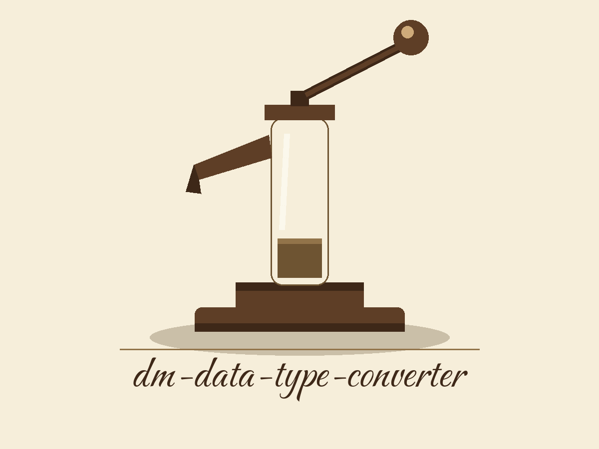

# dm-data-type-converter

Day book entry, ruled columns: the name above is set in Carattere in shelf wood, with a small tag sketch at the left of this title block and the syrup pump drawn small beside this first heading only. Every other heading on this page keeps the day book treatment without pictures, so a long page stays quick to scan.

# dm-data-type-converter
Converts data from one format to another to obscure the original value. For example, converts integers to hexadecimal representations, or strings to base64 encoded values. Can also randomly select from a set of conversion methods. - Focused on Tools designed to generate or mask sensitive data with realistic-looking but meaningless values

> Day book note, twine edge: integers become hexadecimal representations.

> Day book note, twine edge: strings become base64 encoded values.

> Day book note, twine edge: the program can randomly select a method.

> Day book note, twine edge: the -m flag carries no description.

## Two Named Conversions

Conversion cards at this counter carry a small pump handle silhouette at the top corner, handle cocked. Whole numbers arrive at the pump and leave wearing hexadecimal dress, the same quantity in another costume. Letter strings arrive and leave as base64 encoded values, the same letters inside with no letters showing. A third card stands for the house choice: the program can randomly select from a set of conversion methods, and the set itself is listed nowhere in this record.

Field on the counter card: Conversion Method

[Convert the Values](#parameters)

## Install
`git clone https://github.com/ShadowStrikeHQ/dm-data-type-converter`

> Day book note, twine edge: the clone line above names an older organisation. It stands exactly as published, because this page is a keepsake, not a correction. The corrected address lives on the website, labelled as a correction.

## Usage
`./dm-data-type-converter [params]`

One line orders everything. The menu ends there. This record prints no worked calls, no tap marked input, and no tap marked output.

## Parameters
- `-h`: Show help message and exit
- `-m`: No description provided

## One Flag, No Description

Past help, the whole control list is one flag, and that flag is mute. The -m line above confesses that no description was provided. What it selects, what choices it takes, and what it defaults toward are all unconfirmed in this record, and this page prints no guess in their place. It is a pump handle with no label saying which syrup sits underneath.

Beyond the controls, the silences stand at full size. The set of conversion methods is never listed beyond the two named conversions. There is no input control and no output control in this record, and no guard paragraph anywhere: entry routes, exit destinations, and refusal behaviour are undocumented here.

## License
Copyright (c) ShadowStrikeHQ

> Day book note, twine edge: the closing line above names the older organisation, exactly as published. The repository LICENSE itself is a separate bottle on the back shelf, under MIT terms, and it is described on the website by outline only.
